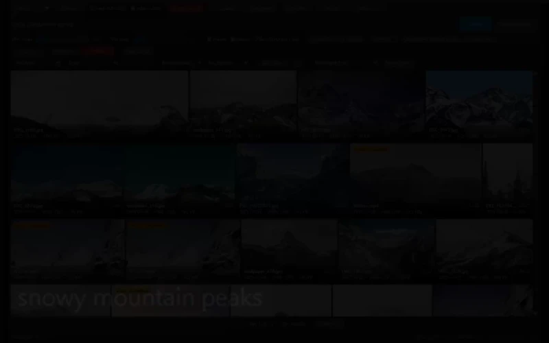

# Vibekimus — local AI search for your photos and videos

[](https://creativecommons.org/licenses/by-nc-sa/4.0/)


Search your photos and videos by **describing them** (*"a man drinking beer"*, *"a purple car in a parking lot"*),
by **an example picture**, or by **both at once** (*a picture + "at night"*) — completely offline, on your own
computer. Nothing is uploaded, nothing is tracked.

> **Vibekimus is a fork of [Makimus-AI](https://github.com/Ubaida-M-Yusuf/Makimus-AI) by Ubaida M Yusuf.**
> It started from Makimus-AI's code and idea, and is now developed **independently** of the original project:
> most of the program has been rewritten, and changes are not exchanged between the two projects. It is not
> affiliated with or endorsed by the original author. See
> [What is different from Makimus-AI](#what-is-different-from-makimus-ai) and [Origin and license](#origin-and-license).


<p align="center">
  
</p>

# A Human's note
Vibekimus, as the name suggests, is developed by leveraging LLMs heavily (Claude Code - Opus 5.5 and Fable 5.2, to be exact).

This fork of Makimus-AI (created by Ubaida M Yusuf) started as an improved version for my personal use and needs, then started growing in scope, and now I think it could be useful for more people.

Currently it’s supported on Windows 11 and Nvidia hardware (RTX 20+, with the possibility of running on GTX 16 series but it hasn’t been tested), as that’s what I personally use.
Linux + Nvidia is next in line and high priority. After that, I have an idea of using ZLUDA to support AMD hardware, but that needs to be investigated further at a later date.
No plans for Intel Arc currently.

I tried to guide Claude throughout this project the best I could, but for sure AI bloat in the code is a given and there’s a lot to be done on the human code review side.

The rest of the readme was written by Claude. I will rewrite it in my spare time so it looks better.

---

## Contents

- [Features](#features)
- [What is different from Makimus-AI](#what-is-different-from-makimus-ai)
- [Requirements](#requirements)
- [Installation](#installation)
- [Using it](#using-it)
- [Privacy and security](#privacy-and-security)
- [Tests](#tests)
- [Origin and license](#origin-and-license)

---

## Features

**Search**
- **SigLIP 2 SO400M**: fast (about 200 pictures per second while indexing on an RTX 5090) and multilingual; text
  written in pictures is read by OCR.
- Search by text, by a picture (button, drag and drop, or **Ctrl+V** from the clipboard), or by a picture **and**
  text together (*"this, but in winter"*).
- **Find similar** on any result, also combined with the text in the search field.
- **Negative terms**: `cat -dog`, `beach -"sun umbrella"`.
- **Text in pictures (OCR, PP-OCRv6)**: a phrase in `"quotes"` must be written on the picture; loose words that
  appear on it raise the result. Reads 50 languages, including diacritics.
- **More like this / less like this**: rate a few results ▲ / ▼ and refine the search with them.
- **Filters and sorting**: date taken (from EXIF), resolution, file size, folder, and type of picture (photo, meme,
  screenshot, anime or drawing, document); sorting by relevance, date, size, resolution or space to free.

**Videos**
- Videos are searched frame by frame; a result shows the best matching moment.
- A video has a **timeline of matching moments**; play the video from any of them in PotPlayer, VLC, MPC-HC or mpv.
- Video decoding on the graphics card; a length limit and a time budget per video keep long recordings from
  holding up indexing.

**Libraries**
- **Indexes of one or more folders**, kept in the program's data and named by you; folders can be added to or
  removed from an index later.
- **Scan all drives**, skipping system folders, tiny icons and cloud-only files (they are never downloaded).
- A list of **saved indexes**, **Find on this PC** for indexes made earlier, and the last index opened
  again at start.
- **Exclusions**: leave out folders or name patterns from every search.

**Tools**
- **Duplicates**: groups of the same picture, with the copy worth keeping marked (highest resolution, then largest
  file, then oldest); nothing is selected or deleted for you.
- **Explore**: your pictures grouped into topics without typing anything; open a topic or split it further.
- **Statistics**: pictures and videos by year, format, folder and type, text found, duplicates, index size.
- **Preview** on the Space bar: the picture full size, its details and text, arrow keys to move through the results.

**Working with results**
- A justified grid of tiles; **Ctrl + mouse wheel** changes the thumbnail size.
- Click selects, double click opens; rubber-band selection; select all on the page or in all results.
- Copy, move, or delete to the Recycle Bin; copy files or the picture itself to the clipboard; drag results into
  other programs.

**Everything else**
- **Index encryption** (AES-256-GCM) with the key protected by your Windows account or by a password.
- A **single .exe** of about 15 MB that downloads and verifies its libraries and the model on first start.
- A console window on the **`** key, a Settings window with an Advanced tab for 23 technical options.

---

## What is different from Makimus-AI

Vibekimus was forked from Makimus-AI (single-file version, `Makimus-AI.py`) and has since diverged in almost every
part. The main differences:

### Security and privacy

| | Makimus-AI | Vibekimus |
|---|---|---|
| Index file format | Python `pickle` (`.pkl`) loaded automatically from the chosen folder — a planted file could run any code | `.npz` with `allow_pickle=False`: numbers and JSON only |
| Paths inside an index | trusted | validated: copy / move / delete cannot be pointed outside the indexed folders, and an index can hold only picture or video files (never `.exe`, `.bat`, `.lnk`) |
| Network | model downloaded at first run; Hugging Face telemetry on | fully offline by default; telemetry off; models and libraries downloaded only when you ask, from a fixed list of hosts, checked by SHA-256 |
| Index encryption | — | optional AES-256-GCM for indexes, OCR text, exclusions and the saved-index list |
| Logs | — | the program log holds no queries or file names; with encryption on, nothing that names your files is written in plain text |
| Image safety | no pixel limit | limit against decompression bombs; formats guessed from file content only from a safe list (no EPS / Ghostscript) |

### Model

- **SigLIP 2 SO400M** instead of CLIP ViT-L-14 (LAION-2B): faster, multilingual, and paired with **OCR** for text
  written in pictures. Every model keeps its own index files, so a model added later never mixes with it.
- SigLIP's 4.5 GB float32 download is turned once into a **2.9 GB compact file** that gives bit-identical vectors.
  **VRAM Save** halves its memory on the card.
- The model is built directly on the graphics card: about 6 s to a ready model instead of about 12 s.
- The experimental ONNX path of the original (ViT-L-14 only) was removed.

### Search

- New: OCR text search, picture + text, Find similar, ratings ▲▼ with Refine, filters by date, resolution, size,
  folder and type, sorting, and search with a picture from the clipboard.
- The index is kept on the graphics card in half precision, and the best results are picked without sorting
  everything. Filters apply **before** the best results are chosen, so a filter never empties a page.
- Changing a filter re-runs the search that is shown, whether it is text, picture, Find similar, a topic or
  duplicates.

### Videos

- Each frame is indexed at the exact moment it is labelled with. In the original the indexed frame came from about
  2 s earlier, so the thumbnail and the playback position showed something else.
- **Matching moments** per video, with a timeline in the preview and playback from a chosen moment.
- Videos are decoded in parallel, on the graphics card by default: about 8–9 videos per second instead of about
  1.4.
- A **length limit** and a **time budget per video** keep long recordings from blocking indexing.
- Fast seeking in `.wmv` files whose frames carry no time stamps, through PyAV.

### Libraries and indexes

- Indexes of several folders, the list of saved indexes, Find on this PC, adding and removing folders, and the last
  index reopened at start.
- Scan all drives: skips system folders, tiny icons and cloud-only files, and keeps the entries of a disconnected
  drive.
- **Auto-save** appends only the new rows every 5 minutes instead of rewriting the whole index, which is easier on
  SSDs. An index is never replaced by a smaller one by mistake.
- Pictures whose extension does not match their content (a PNG named `.jpg`) are indexed instead of skipped.
- Missing dates, sizes and dimensions are filled in from file headers on Refresh.

### Tools and interface

- New: Duplicates, Explore, Statistics, the Space preview, the console window, and the Settings window with General
  and Advanced tabs.
- **Responsive layout**: the toolbars wrap instead of cutting controls off.
- **Click / double click**:
  - click selects and double click opens, without the selection blinking;
  - a slightly moved click is not taken for a drag;
  - a result dragged out and dropped back is ignored.
- Results are shown by the window's own thread; the original touched widgets from worker threads.

### Performance

The indexing pipeline measured on an RTX 5090, with the same model and the same files:

| | Makimus-AI | Vibekimus |
|---|---|---|
| Pictures indexed per second | ~130 | 180–200 (the model's ceiling is ~235) |
| Videos indexed per second (≤ 60 s) | ~1.4 | 7.5–9 |
| Stop indexing | 1–1.5 s for pictures, minutes for videos | about 0.3 s |

- JPEGs are decoded at reduced size, and large PNGs are reduced right after decoding.
- **nvJPEG** decoding on the card is optional.
- Each drive is checked for being a spinning disk, which is then read one file at a time.
- OCR runs on the graphics card in several processes. The number of processes adapts to free graphics memory, and
  two CPU cores are always kept free for the rest of the computer.

### Packaging

- `Install.bat` / `Run.bat` call the venv's Python directly, with no activation step.
- `Build-Exe.bat` makes a **single 15 MB `Vibekimus.exe`**. On first start it downloads its libraries (about 3 GB)
  with a progress bar and resume, checks every file by SHA-256, checks the graphics card and driver, and then
  downloads the model. Its data goes to `%LOCALAPPDATA%\Vibekimus`.

### Code

- The 3,854-line `Makimus-AI.py` became the `vibekimus` package of focused modules: models, indexes, indexing
  passes, search, OCR, encryption, and the interface split into its parts. The code follows OOP and SOLID, with
  named constants and PEP 8.
- Every setting is in `vibekimus/settings.py`, and most of them can be changed in the Advanced tab.
- **222 automated tests** (pytest), with fake models for the logic and real-hardware tests that skip themselves
  where the hardware is missing.

### Not carried over

- **Platforms**: Vibekimus is developed and tested on **Windows with an NVIDIA card**. The original's instructions
  for Linux, macOS, AMD (DirectML) and CPU-only installs are not part of this project.
- **Indexes from Makimus-AI** (`.pkl`) are not read, for the security reason above. Index the folders again.
- The original's donation links and Patreon installer belong to the original project.

---

## Requirements

- Windows 10 or 11
- An NVIDIA graphics card from RTX 20 / GTX 16 on (compute capability 7.0 or newer) with a current driver
- For running from source: Python 3.12
- Disk space: about 5 GB for the libraries and about 3 GB for the model

---

## Installation

### From source

```bat
Install.bat
```

creates `venv`, installs the libraries from `requirements.txt` and `requirements-ocr.txt` and starts the program.
After that, start it with `Run.bat` (or `venv\Scripts\python Vibekimus.py`).

The models are downloaded on request, from inside the program: the search model at the first start, the OCR
model when you tick **Read text (OCR)**.

### Single .exe

```bat
Build-Exe.bat
```

makes `dist\Vibekimus.exe`. Copy it anywhere and run it. On first start it downloads its libraries and then the
model, each with a progress bar.

---

## Using it

1. **Library → New index…**: name it and add one or more folders. Indexing starts right away. Tick **Index videos**
   and **Read text (OCR)** first if you want those too.
2. Type a description and press **Enter**. Or drop a picture on the results, use **Search by image…**, or press
   **Ctrl+V** with a picture in the clipboard.
3. Use **Refresh** after adding or removing files: only what changed is processed.

| Key | Action |
|---|---|
| Click / double click | select / open (a video plays from the matching moment) |
| Space | preview the result under the mouse; ← → move, Enter open, Esc close |
| + / − (in the preview) | rate ▲ more like this / ▼ less like this |
| Ctrl + mouse wheel | thumbnail size |
| Ctrl+C | copy the selected files to the clipboard |
| Ctrl+V | search with the picture in the clipboard |
| ` | console window |

---

## Privacy and security

- Search, indexing and OCR run on your computer. After the models are downloaded, the program works with the
  network cable unplugged.
- Index files are kept in the program's data folder (indexes of a single folder made by older versions: in that
  folder) and are never sent anywhere.
- With **Library → Index encryption…** on, every file that names your pictures is encrypted. The key is protected
  by your Windows account or by a password, and can be exported as a password-protected backup.
- Files in your folders are only read. Only **Move** and **Delete** (to the Recycle Bin) change them, and only when
  you ask.

---

## Tests

```bat
venv\Scripts\python -m pip install -r requirements-dev.txt
venv\Scripts\python -m pytest
```

The tests that need an NVIDIA card or the OCR model skip themselves where they are missing.

---

## Origin and license

Vibekimus is a fork of **[Makimus-AI](https://github.com/Ubaida-M-Yusuf/Makimus-AI)** by **Ubaida M Yusuf**, which
in turn took ideas from **[jareddishman's fork](https://github.com/jareddishman/Makimus-AI)** (video search, bulk
file operations, exclusions, negative search terms). Thank you to both for the original idea and code.

Vibekimus is developed independently. Bugs and requests about Vibekimus belong here, not in the original project.

Like the original, Vibekimus is licensed under
[Creative Commons Attribution-NonCommercial-ShareAlike 4.0](https://creativecommons.org/licenses/by-nc-sa/4.0/)
(see [`LICENSE`](LICENSE)). You may share and change it, with credit, not for commercial use, and under the same
license.

The models are not part of this repository and come with their own licenses:
[SigLIP 2](https://huggingface.co/timm/ViT-SO400M-16-SigLIP2-384) (Apache 2.0) and
[PP-OCRv6 small](https://huggingface.co/PaddlePaddle) (Apache 2.0).
